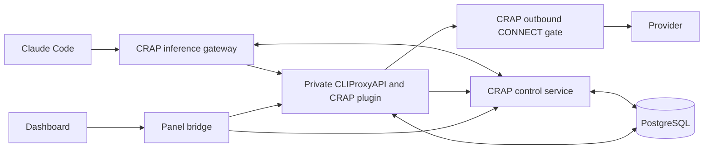

# Architecture

[Documentation index](README.md)

CRAP connects to an independently installed official CLIProxyAPI through supported
hooks. It does not vendor, build, patch or publish the engine. See the
[connection guide](connecting-cliproxy.md).

## Responsibilities

| Component                 | Owns                                                                                               |
| ------------------------- | -------------------------------------------------------------------------------------------------- |
| Dashboard and Node bridge | Setup, management UI, integration coordination, client enrollment                                  |
| Inference gateway         | Client admission, required readiness, strict request handling and outbound grants                  |
| Native CRAP plugin        | Exact-account execution through native hooks, quota/usage observations and delivery spool          |
| CRAP control service      | Durable family bindings, reserve policy, quota observations, ledger, prices and encrypted settings |
| CLIProxyAPI               | Provider protocol translation, native OAuth refresh and HTTP execution                             |
| PostgreSQL                | Separate CRAP and CLIProxy schemas, persisted state                                                |
| Tailscale helper          | Private HTTPS access and allowed-identity checks                                                   |

## What reaches which service first

A configured Claude client reaches the CRAP gateway first. The gateway selects
and admits a request, then the private proxy plugin invokes the native executor
with the selected account. A request-scoped grant controls outbound access.
The raw proxy is not published and has no direct internet route in the supported
composition. Disabling or skipping the mandatory plugin cannot silently restore
round-robin inference.

This does not make the native executor a byte-for-byte transport. Upstream still
applies its provider authentication, headers, translation and payload processing.
CRAP's CONNECT gate does not decrypt TLS or rewrite provider traffic.

This boundary assumes a trusted pinned engine, plugin and operator. It is not a
sandbox against hostile native plugins or someone who can change Docker topology.

## Durable state and observations

The CRAP plugin persists observed delivery events before sending them to control.
Acknowledged events leave the spool; duplicate delivery is idempotent and conflicts
are retained for inspection. PostgreSQL links lifecycle and usage observations by
opaque trace identity. It does not store prompts or conversation bodies in the
accounting ledger. Requests still pass through process memory during execution.

A crash before upstream delivers a callback can lose an observation. Durable
spooling cannot reconstruct callbacks that never arrived. See
[accounting limitations](accounting.md).

## Scope

One active gateway and credential-owning proxy are supported. PostgreSQL persistence
and shared refresh admission do not provide safe active-active credential refresh,
stream handoff or Kubernetes rolling updates. See [storage](storage.md) and the
[detailed execution contract](../deploy/STRICT-ROUTING.md).
